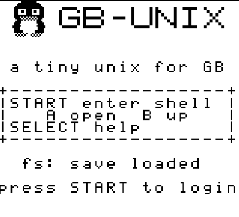

# gb-unix —  Unix filesystem-like for Game Boy



A playable Game Boy ROM that boots into a tiny Unix-like environment: a file
browser over a fake root filesystem (`/`, `/bin`, `/etc`, `/home/user`, ...)
plus a mini shell (`gbsh`) where you type real commands on an on-screen
keyboard. The shell remembers recent commands, the editor (`gbedit`) lets you
change files on the Game Boy itself, and `top` shows a live system monitor.
Files you create survive power-off via battery-backed SRAM — exactly like a
game save.

Written in **RGBDS assembly**, with the `gbsh` shell's `pwd`/`echo` output
path implemented in C (compiled with [SDCC](https://sdcc.sourceforge.net/)
to RGBDS-syntax assembly and assembled with `rgbasm`). The ROM is 32 KB,
MBC1 with 8 KB battery-backed RAM (cart type `0x03`).

## Controls

| Key | Browser mode | Shell mode | File pager | Text editor (`gbedit`) |
|---|---|---|---|---|
| **D-Pad Up/Down** | Move cursor in listing | Move on on-screen keyboard | Scroll 1 line | Move on keyboard |
| **D-Pad Left/Right** | Page up/down | Move on keyboard (wraps) | Page up/down | Move on keyboard (wraps) |
| **A** | Enter dir / open file | Type character | Close | Insert selected character |
| **B** | `cd ..` (parent dir) | Backspace | Close | Backspace (joins lines at column 0) |
| **B + Up** | Jump to `/` | — | — | Move text cursor up |
| **B + Down** | Jump to `/home/user` | — | — | Move text cursor down |
| **B + Left/Right** | — | — | — | Move text cursor left/right |
| **B + A** | — | — | — | Insert newline |
| **Start** | Enter shell (`gbsh`) | Execute command | Close | Save file and quit |
| **Select** | Toggle long listing (`drwxr-xr-x`) | Toggle shift layer (caps/symbols) | — | Toggle shift layer |
| **Select + Up/Down** | — | Previous/next command in history | — | — |
| **Select + Start** | Key help | Leave shell (back to browser) | — | Quit without saving |

In the key help, **Up/Down** scrolls one line, **Left/Right** pages, and
**A/B/Start** returns to the previous screen.

In the `top` monitor, **B**, **A**, or **Start** returns to the shell.

On the title screen, **Start** or **A** logs in and **Select** opens the key
help. A tiny pixel-art Tux + `GB-UNIX` logo tops the splash, and an 8-bit
chiptune jingle (pulse melody + bass + noise hat) loops here only.

## The screens

1. **Title** — boot screen with the Tux + `GB-UNIX` splash; Start/A logs in,
   Select opens the key help. The splash jingle plays on this screen only
   (stopping the moment you log in or open the key help).
2. **Browser** — an `ls`-style listing of the current directory with a cursor.
   The header shows the cwd path, the footer shows the selected item's info
   (`name`, item count for dirs, `sizeB ro/rw` for files). Select toggles the
   long listing: `drwxr-xr-x bin`.
3. **File pager** — full-screen text view of a file's contents, scrollable
   with Up/Down, paged with Left/Right, closed with A/B/Start.
4. **Shell** — a scrolling 20×11 terminal with a path prompt (`/$`, `/etc$`,
   `/home/user$`; deep paths fall back to their basename), an input line, and
   a 6×10 QWERTY-ish on-screen keyboard (lowercase letters, digits, symbols
   via the shift layer). Select+Up/Down browses the command history;
   Select+Start returns to the browser, while `exit` logs out to the splash.
5. **Text editor (`gbedit`)** — a full-screen editor with a 9-line text view,
   horizontal scrolling for long lines, and the same on-screen keyboard.
   Start saves and quits; Select+Start quits without saving.
6. **Key help** — a scrollable full-screen reference covering the title,
   browser, pager, shell, `gbedit`, and `top` controls. Opened with Select on
   the title screen or Select+Start in the browser. Up/Down scroll one line,
   Left/Right page, and A/B/Start returns to the previous screen.
7. **System monitor (`top`)** — a full-screen top-style dashboard with a
   once-per-second uptime clock, the running main-loop task, inode counts,
   and SRAM heap use. B, A, or Start returns to the shell.

## Shell commands

`gbsh` implements these commands:

| Command | Description |
|---|---|
| `help` | List the commands and the shell's key bindings |
| `ls [-l] [PATH]` | List a directory (or print a file's name); `-l` shows the long form `drwxr-xr-x dir` / `-rw-r--r-- 48B file` |
| `cd [PATH]` | Change directory; `cd` with no argument goes to `/home/user` |
| `pwd` | Print the current directory path (`/ (root)` at the root) |
| `cat FILE...` | Print one or more files to the terminal |
| `echo [TEXT...]` | Print text; `echo TEXT > FILE` writes the text into a file |
| `mkdir DIR` | Create a directory |
| `rmdir DIR` | Remove an empty directory |
| `rm FILE` | Remove a file |
| `touch FILE` | Create an empty file (no-op if it already exists) |
| `gbedit FILE` | Open `FILE` in the text editor; creates it when missing |
| `clear` | Clear the terminal |
| `whoami` | Print the current user |
| `uname` | Print the system name |
| `uptime` | Print time since boot (minutes and seconds) |
| `top` | Open the live system monitor (uptime, tasks, inodes, SRAM heap) |
| `motd` | Print the message of the day (`/etc/motd`) |
| `exit` | Log out: return to the splash screen (`Select+Start` returns to the browser instead) |

### Shell history

`gbsh` keeps the last eight non-empty commands in RAM:

- Hold **Select** and press **Up** to recall older commands.
- Hold **Select** and press **Down** to move forward again.
- Moving forward past the newest entry restores the line you were typing
  before you started browsing.
- **Start** adds the current line to history; repeating the previous command
  does not create a duplicate.
- History survives a trip through `gbedit` or `top` and back, but a power
  cycle clears it.

A quick **Select** tap still toggles the shift layer. The history shortcut
only fires while Select is held with Up/Down.

### gbedit

`gbedit FILE` opens `FILE` for editing and creates it when missing:

```text
/$ gbedit note
```

The editor uses the same on-screen keyboard as the shell and shows nine text
rows at a time. Long lines scroll horizontally; longer files scroll
vertically.

| Key | Action |
|---|---|
| **D-Pad** | Move the keyboard cursor |
| **A** | Insert the selected character |
| **B** | Backspace; at column 0, join with the previous line |
| **B + D-Pad** | Move the text cursor |
| **B + A** | Insert a newline |
| **Select** | Toggle the shift layer |
| **Start** | Save the file and return to the shell |
| **Select + Start** | Discard changes and return to the shell |

Notes:

- Only files in SRAM can be edited. ROM files such as `/etc/motd` and
  `/home/user/readme.txt` are read-only and return
  `error: operation not permitted`.
- The edit buffer holds up to 2047 bytes. Larger files are rejected with
  `error: file too large`.
- Saving reuses the file's existing SRAM space when the new contents fit; a
  larger file gets fresh heap space. If the SRAM heap is full, the editor
  stays open with `error: no space left on device`, so you can delete
  something and try again.
- Missing files are created in the current directory. Parent directories
  must already exist.
- There is no undo: Select+Start is the escape hatch for a bad edit.
- `cat /bin/gbedit` shows the same short manual page from inside the ROM.

### top

`top` opens a full-screen, top-style system monitor:

```text
GB-UNIX top
up 12m 34s
--------------------
 PID STAT COMMAND
  1  R  main loop
tasks: 1 running
--------------------
inodes: 48/96
files: 33  dirs: 15
heap: 2048/6240 B
free: 4192 B
SRAM: 8 KB
--------------------
A/B/START: back
```

The uptime line refreshes once per second while the screen is open. The
inode, file/directory, and heap numbers are a snapshot taken when `top`
starts. **B**, **A**, or **Start** returns to the shell.

There is no process scheduler in gb-unix: the whole system is one cooperative
main loop, so the task table always reports the single `main loop` task.
`top` is a system monitor, not a process manager.

### Key help

**Select** on the title screen, or **Select+Start** in the browser, opens the
scrollable key reference. It covers the title screen, browser, pager, shell,
`gbedit`, and `top`:

- **Up/Down** scroll one line.
- **Left/Right** page up/down.
- **A**, **B**, or **Start** returns to the previous screen.

The bottom row always shows the scroll and close hint, so the controls for
help itself are visible no matter which page is open.

Notes:

- Command names are case-insensitive, so `PWD` and `pwd` both work (handy when
  the on-screen keyboard's shift layer is on); paths stay case-sensitive.
- `mkdir`, `touch`, `rm`, `rmdir` and `echo >` print what they did
  (`created w`, `removed w/n`, `wrote w/n`), so a silent screen always
  means a problem, never a missed keystroke.
- The system tree shipped in ROM is immutable: `rm /etc/motd`,
  `rmdir /tmp` or `echo x > /etc/hostname` fail with
  `error: operation not permitted`. Files and directories you create are
  yours to change.
- `echo hello > file` writes `hello\n` into `file` (output redirection).
- `cat` reads both the read-only system files (from ROM) and files you created
  (from SRAM); several files can be given, and directories or missing files
  print an error.
- Every built-in has a file in `/bin` (`cat`, `cd`, `clear`, `echo`, `exit`,
  `gbedit`, `help`, `ls`, `mkdir`, `pwd`, `rm`, `rmdir`, `sh`, `touch`,
  `top`, `uname`, `uptime`, `whoami`) holding a short man-page-style note —
  `cat /bin/pwd` explains `pwd` and how to run it. They are documentation,
  not separate programs (gbsh is a built-in shell), but you can still run
  them by path:
  `/bin/pwd`, `bin/echo hi` and `./pwd` all invoke the built-in named after
  the last path component, so the files in `/bin` are not just decoration.
- Paths may be absolute (`/etc/motd`) or relative (`motd`, `../etc/motd`).
  `.` and `..` components are handled.
- Unknown commands report `not found: <name>`; a one-key typo of a known
  command adds `did you mean: <name>` (e.g. `ped` → `pwd`). Failed operations
  print `error: <reason>` (no such file, file exists, no space left, name too
  long, not a directory, operation not permitted, ...).

## Filesystem design

- **ROM banks** hold the *pristine* system tree as a compact descriptor:
  a node table (name/type/parent/child/sibling, 20 bytes per inode) plus
  read-only file contents (motd, `/proc/cpuinfo`, man page, readme, a stub
  binary per shell built-in, ...).
  On first boot the descriptor is copied into SRAM.
- **SRAM (8 KB, MBC1+RAM+BATTERY)** holds the *live* state:
  - `GBUX` magic + format version header; on mismatch the tree is
    re-initialized from the ROM descriptor (fresh format).
  - Node table copy (96 inodes) + a bump-allocator heap for user file
    contents.
  - `mkdir`/`touch`/`rm`/`rmdir`/`echo x > f` mutate SRAM nodes; `cat` reads
    ROM or SRAM depending on where the file lives.
- Emulators persist the SRAM automatically:
  - **PyBoy** writes it as `gb-unix.gb.ram` next to the ROM.
  - **mGBA / SameBoy / BGB / real hardware** use `gb-unix.sav`.
  Delete that file to reset the filesystem to its pristine state.

## Building

The Makefile uses the prebuilt [RGBDS](https://rgbds.gbdev.io/) in
`tools/rgbds/`, so `make` works without installing `rgbasm`/`rgblink`/`rgbfix`.
[SDCC](https://sdcc.sourceforge.net/) (`sdcc`, 4.2+) is only needed to
recompile the C module after editing `src/*.c`; if it is not installed, the
build uses the checked-in `src/generated/shcmd_sdcc.asm`.

```sh
make            # builds gb-unix.gb
make clean      # remove build artifacts
make shcmd      # regenerate src/generated/shcmd_sdcc.asm (needs SDCC)
```

When SDCC is available, the C sources (`src/*.c`) are compiled to
RGBDS-syntax assembly (`--asm=rgbds --no-peep`) and assembled with `rgbasm`;
C artifacts land in `build/`. Override `AS`/`CC`/`LD`/`FIX` in the Makefile
(or `RGBDS_DIR`) to use system tools instead of the bundled ones.

## Running

Open `gb-unix.gb` in any Game Boy emulator (mGBA, SameBoy, PyBoy, BGB, ...)
or flash it to hardware. Try:

1. START → browser. Move around the root tree, SELECT for the long listing.
2. A on a directory to enter it, B to go back up, A on a file to page it.
3. START → shell. Type `help` on the keyboard, START to run.
4. `gbedit note` — type a few lines (B+A makes a newline), START to save and
   quit, then `cat note` to read it back.
5. Run a few commands (for example `uname`, `pwd`, `uptime`), then hold SELECT
   and press UP/DOWN to browse the command history. START runs a recalled
   command.
6. Type `top` to open the live system monitor; A, B, or START returns to the
   shell.
7. `mkdir demo` / `touch note` / `echo hi > note` — then power-cycle the
   emulator: your files are still there. Command history is RAM-only and
   resets at power-off.

## Project layout

```
gb-unix/
├── Makefile            — sdcc (C) + rgbasm → rgblink → rgbfix, outputs gb-unix.gb
├── README.md
├── build/              — build artifacts (objects, generated asm)
├── tools/              — prebuilt RGBDS + genfont/genlogo/genfs generators
└── src/
    ├── main.asm        — entry point, cart header, boot, title splash, main loop
    ├── hardware.inc    — hardware register equates
    ├── font.asm        — custom 8×8 font incl. lowercase
    ├── text.asm        — print/scroll/cursor text engine (20×18 char grid)
    ├── help.asm        — full-screen key help
    ├── input.asm       — polled joypad with edge detection
    ├── fs.asm          — path resolve, tree walk, ls/cat/mkdir/rm logic
    ├── sram.asm        — SRAM enable, init/format, inode alloc, content heap
    ├── browser.asm     — browser UI
    ├── pager.asm       — file viewer
    ├── editor.asm      — gbedit text editor
    ├── top.asm         — top-style system monitor (uptime, inodes, heap)
    ├── shell.asm       — tokenizer, command table, executors, tty, history
    ├── music.asm       — splash-screen chiptune sequencer + song data
    ├── shcmd.c         — C: pwd/echo output (SDCC → RGBDS asm, see cwrite.asm)
    ├── cwrite.asm      — asm store/load helpers used by shcmd.c
    ├── keyboard.asm    — on-screen keyboard grid
    ├── fsdata.asm      — the filesystem content itself (motd, man pages, ...)
    └── logodata.asm    — generated splash logo tiles (tools/genlogo.py)
```

## Limitations

- 96 inodes total, 30-char command lines, 11-char file names (like classic
  Unix!). The SRAM content heap is 6240 bytes; a single `gbedit` file is
  limited to 2047 bytes.
- Shell history holds eight commands in WRAM; it is not saved to SRAM.
- `top` shows one task because gb-unix has no process scheduler; only the
  uptime line changes while the monitor is open.
- File pager shows ASCII text; binary files render their bytes as text.
- The clock is frame-accurate only while the console is on (uptime resets on
  boot — no RTC).

## Status

Complete: boot/title, browser (short + long listing), pager, shell with
on-screen keyboard, command history, full command set, `gbedit` text editor,
`top` system monitor, SRAM persistence of
`mkdir`/`touch`/`rm`/`rmdir`/redirection/edited files across power cycles.
